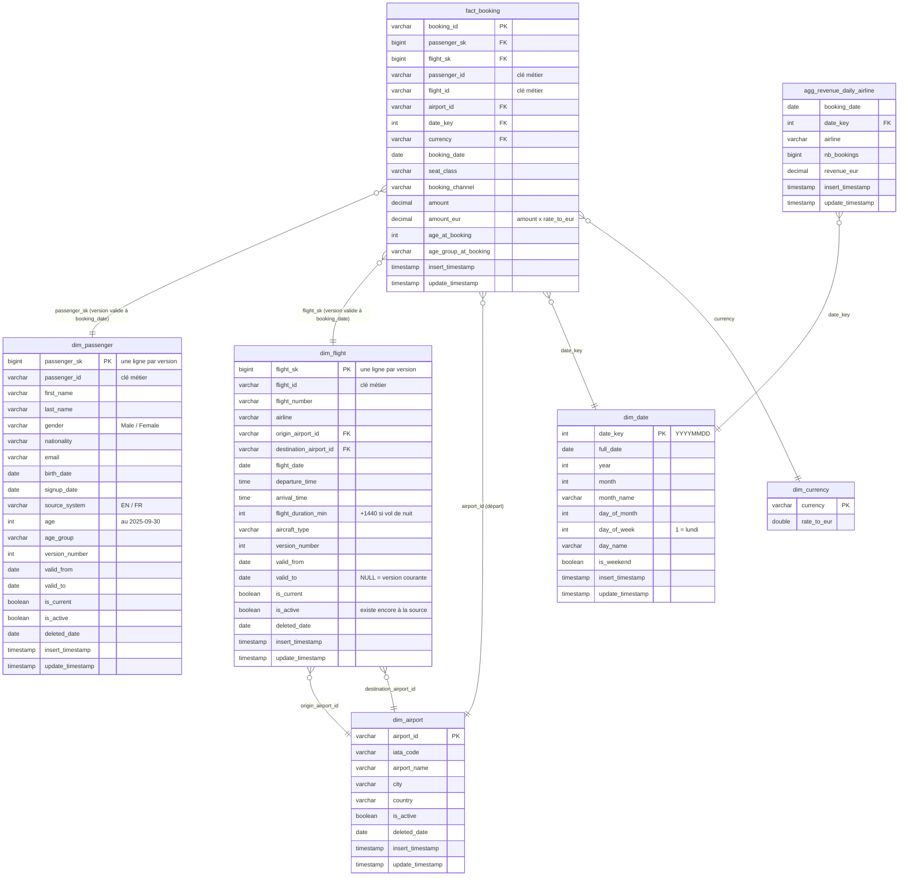

# Documentation — pipeline médaillon de la compagnie aérienne

Pipeline d'ingestion bronze → silver → gold, avec DuckDB, sur un mois de données (septembre 2025)
précédé d'un état initial (`init/`). Tout est régénérable depuis un clone propre :

```powershell
python -m venv venv; .\venv\Scripts\activate; pip install -r requirements.txt
cd ingestion; python run_month.py                    # ou, en bonus :
dagster dev -f dagster_pipeline/definitions.py       # depuis la racine, puis « Materialize all »
```

## 1. Ce que disent les données (et ce qui en découle)

L'observation des fichiers jour par jour (diff J vs J-1) conditionne toute la stratégie de chargement :

| Fichier | Clé | Type d'export | Changements observés sur le mois | Nature | Chargement silver |
|---|---|---|---|---|---|
| `airports` | `airport_id` | snapshot complet | 1 modification, 1 ajout | référentiel | upsert + désactivation |
| `flights` | `flight_id` | snapshot complet | ajouts, modifications (horaires…), 18 suppressions | référentiel | upsert + désactivation + historique SCD2 |
| `passengers_en` / `passengers_fr` | `passenger_id` / `id_passager` | snapshot complet (par système) | ajouts quotidiens, corrections, 7 suppressions | référentiel | union normalisée → upsert + désactivation + historique SCD2 |
| `bookings` | `booking_id` | **incrémental** (seulement les réservations du jour) | aucune : une réservation n'est jamais modifiée | évènement | **insert** idempotent |

- **Snapshot complet ≠ incrémental.** Pour un snapshot complet, une clé absente du fichier du jour a
  été supprimée à la source. Pour les réservations, une clé absente a simplement été créée un autre
  jour : la désactivation ne s'applique donc jamais aux bookings.
- **Deux systèmes passagers.** Les ids EN et FR sont disjoints. Le système FR a ses propres noms de
  colonnes, `Homme/Femme` et des dates `DD/MM/YYYY`. Les deux sont ramenés à un schéma unique, avec
  une colonne `source_system`. La désactivation est calculée sur l'**union** EN + FR : faite fichier
  par fichier, le snapshot EN désactiverait tous les passagers FR.
- **Vols de nuit.** 193 vols sur 714 arrivent à une heure « antérieure » à leur départ. Ils arrivent
  le lendemain : la durée prend alors +1440 min.
- **Données propres.** Il n'y a ni NULL ni clé en double. Les CSV sont lus tout en texte
  (`dtype=str`) et typés en silver.

## 2. Les trois couches

**Bronze** (`common.fetch_csv`). C'est une copie brute, octet pour octet, des CSV source dans
`bronze/<init|2025-09>/`. Un fichier déjà présent n'est jamais retéléchargé. Le téléchargement
passe par un fichier `.tmp` renommé à la fin : une coupure ne laisse donc jamais de fichier tronqué.
Le bronze est immuable et sert de source de rejeu.

**Silver** (`ingest_<entité>.ingest_silver`). Chaque fonction relit le fichier bronze du jour, le type
et le charge selon la stratégie du tableau ci-dessus. Chaque fonction ne lit que ce que la couche
précédente a persisté, pour pouvoir être orchestrée par Dagster.

**Gold** (`ingest_<entité>.ingest_gold`). Chaque table est reconstruite (`CREATE OR REPLACE`) depuis
l'état courant du silver. Le gold est donc une pure fonction du silver, et par là idempotent.

## 3. Modèle gold : faits et dimensions

Le modèle est un **schéma en étoile** dont le fait central est la réservation.

- **`fact_booking`** (grain : une réservation). La réservation est un **évènement** : elle est
  datée, immuable, et porte des mesures (`amount`, `amount_eur`). Elle référence le passager, le vol,
  l'aéroport, la date et la devise.
  - `amount_eur = amount × dim_currency.rate_to_eur`, arrondi au centime.
  - `age_at_booking` / `age_group_at_booking` : l'âge **au moment de la réservation**. C'est ce qui a
    du sens pour analyser le CA par tranche d'âge. 95 réservations ont ainsi une tranche différente
    de la tranche actuelle du passager.
  - `airport_id` est l'aéroport enregistré dans la réservation. On a vérifié sur tout le dataset
    qu'il est égal à l'aéroport de départ de la version du vol réservée.
- **`dim_flight`**, **`dim_passenger`** (SCD2, voir section 4). Ce sont des **référentiels** qui
  évoluent : ils décrivent le contexte d'une réservation et changent dans le temps (horaire modifié,
  email corrigé…).
  - `dim_flight` porte `flight_duration_min`.
  - `dim_passenger` porte `age` / `age_group` au 30/09/2025, une date fixe pour que le gold soit
    reproductible.
  - Les tranches d'âge sont `<18`, `18-24`, `25-34`, `35-49`, `50-64`, `65+`. Elles sont définies une
    seule fois (`common.age_group_sql`) et partagées par la dimension et le fait.
- **`dim_airport`** : le référentiel des aéroports, issu du modèle fourni. Il est rôle-joué par
  `dim_flight` (origine et destination) et par `fact_booking`.
- **`dim_date`** : un calendrier (jour de semaine, mois, week-end) couvrant les dates de réservation
  et de vol. Il permet les analyses par jour de la semaine sans recalcul.
  - C'est la seule table gold qui n'est pas reconstruite : on ajoute seulement les jours manquants.
    Une date ne change jamais, et une reconstruction réécrirait son `insert_timestamp` à chaque
    exécution.
- **`dim_currency`** : fournie, à taux fixes.
- **`agg_revenue_daily_airline`** : nombre de réservations et CA en EUR par jour de réservation et par
  compagnie. Elle est construite dans `ingest_bookings.ingest_gold`, juste après `fact_booking`.
  Bookings étant la dernière entité traitée chaque jour, le fait et toutes les dimensions sont alors
  à jour. La compagnie retenue est celle de la version du vol valide à la date de réservation.

### Diagramme du modèle gold



## 4. Mises à jour, suppressions et historique

**Upsert des référentiels.** On utilise `INSERT … ON CONFLICT (clé) DO UPDATE`.
- `insert_timestamp` n'apparaît pas dans le `SET` : il reste figé à la première apparition.
- Le `DO UPDATE` est conditionné par `WHERE … IS DISTINCT FROM` sur chaque colonne. Une ligne
  n'est donc réécrite, et son `update_timestamp` rafraîchi, que si une valeur a réellement changé
  ou si une ligne désactivée réapparaît. `update_timestamp` date ainsi le dernier vrai changement,
  et rejouer un jour ne touche aucune ligne.

**Suppressions = désactivation, jamais de suppression physique.** Une clé absente du snapshot du
jour passe à `is_active = false`, avec `deleted_date` égale au jour du constat. Le filtre
`is_active = true` garantit que cette date reste figée au premier constat.
- Ces lignes restent en gold, car des réservations passées les référencent : 774 réservations
  portent sur un vol supprimé depuis.
- Une clé qui réapparaît est réactivée et sa `deleted_date` est remise à NULL.

**Réservations : insert pur.** On utilise `INSERT … ON CONFLICT (booking_id) DO NOTHING`. Rejouer
un jour ne crée aucun doublon et ne modifie pas les timestamps.

**Historique SCD2 (bonus)** : tables `silver_flights_history` / `silver_passengers_history`,
via `common.update_scd2_history`.
- **Pourquoi en silver.** L'upsert de `silver_flights` écrase l'ancienne version. Or le gold, qui est
  reconstruit depuis le silver, ne peut versionner que ce que le silver a conservé.
- **Principe.** Chaque version porte un `row_hash` des attributs suivis et une validité
  `[valid_from, valid_to[` (`valid_to` NULL pour la version courante). À chaque snapshot :
  - si le hash change, la version courante est close au jour du snapshot et une nouvelle est
    ouverte ;
  - si la clé disparaît, la version est close sans successeur ;
  - si la clé est nouvelle ou réapparaît, une version est ouverte.
- **Clés substituts.** `flight_sk` / `passenger_sk` sont des `version_id` tirés d'une séquence au
  moment de l'insertion en silver. Elles ne changent donc pas d'une reconstruction du gold à l'autre.
- **Rattachement du fait.** Une réservation pointe vers la version valide à sa `booking_date`
  (`valid_from <= booking_date < valid_to`) : 1553 réservations pointent ainsi vers une version
  qui n'est plus la version courante.
- **Résultat.** 735 versions pour 714 vols (21 vols modifiés) et 2232 versions pour 2221 passagers.
  On a vérifié que l'état reconstitué depuis l'historique est égal, pour chacun des 31 snapshots, au
  fichier source du jour.

**Ordre de chargement et idempotence.** La désactivation et le SCD2 supposent que les snapshots
sont chargés dans l'ordre chronologique. Or relancer `run_month.py` repasse par l'init *après* le
30/09 : sans protection, cela réactiverait des lignes supprimées et ouvrirait de fausses versions.
- La table `silver_load_log` mémorise donc le dernier snapshot chargé par entité. Un snapshot plus
  ancien est ignoré, avec un message. Rejouer le dernier snapshot reste possible et sans effet.
- Résultat : une 2ᵉ exécution complète de `run_month.py` ne modifie plus aucune table, timestamps
  compris (seul `silver_load_log` trace le rechargement).

**Écart assumé par rapport au modèle fourni.** `ingest_airports.py` a été aligné sur les autres
entités par deux changements minimaux, signalés en commentaire dans le code :
- le garde-fou `silver_load_log` ;
- le `DO UPDATE … WHERE`.

Sans eux, relancer le pipeline désactivait temporairement l'aéroport ajouté en septembre (avec une
`deleted_date` au 31/08), et `update_timestamp` changeait à chaque passage. Garder une seule règle
pour tous les référentiels nous paraît plus défendable qu'une exception.

## 5. Orchestration Dagster (bonus)

Le fichier est `dagster_pipeline/definitions.py`. Les assets appellent les fonctions existantes, et
aucune donnée ne transite par Dagster.
- **`init_load`** (non partitionné) : `dim_currency` + l'état initial.
- **`bronze_*` / `silver_*`** : partitionnés par jour sur septembre 2025. Chaque silver dépend de
  **lui-même au jour J-1** : un jour ne peut pas être chargé avant la veille. En backfill, on utilise
  `BackfillPolicy.single_run()` : un seul run parcourt les jours dans l'ordre.
- **`gold_*`** : **non partitionnés**, parce que le gold est une reconstruction complète depuis le
  silver courant. Une partition « gold du jour J » contiendrait en réalité l'état du silver au moment
  du run.
  - Un premier essai avec des gold partitionnés le montrait : le daemon faisait passer tous les
    silver avant les gold.
  - `gold_bookings` dépend des trois dimensions gold.
- **Un seul écrivain DuckDB.** Le fichier n'accepte qu'un processus en écriture : les assets qui
  écrivent dans l'entrepôt sont dans le pool `duckdb`, limité à 1 par `dagster.yaml`.

Vérification : un backfill complet sur un entrepôt vide donne 4 runs en environ 150 s, et un
entrepôt **identique** à celui de `run_month.py` sur les 14 tables (hors timestamps).

## 6. Limites connues

- **Taux de change fixes** (`dim_currency` fournie) : `amount_eur` ne reflète pas le cours du jour
  de la réservation. `dim_currency` n'a pas non plus les colonnes `insert_timestamp` /
  `update_timestamp`, car elle a été laissée telle que fournie.
- **Validité à la journée.** Un snapshot représente l'état en fin de journée. Si un vol est modifié
  le jour même d'une réservation, celle-ci est rattachée à la nouvelle version, faute de savoir
  laquelle des deux a eu lieu en premier.
- **Réservations antérieures au premier snapshot.** Les 464 réservations d'août précèdent le
  snapshot init du 31/08 : elles sont rattachées à la version 1, le plus ancien état connu, qui
  n'était peut-être pas exactement celui du jour de la réservation.
- **Pas de correction rétroactive.** Un snapshot plus ancien que le dernier chargé est ignoré, et
  non réintégré dans l'historique. Pour corriger un jour passé (fichier source republié, par
  exemple), il faut repartir de zéro : supprimer `warehouse.duckdb` et rejouer. Le bronze, lui, est
  conservé.
- **Âge calculé à des dates de référence.** L'âge vaut le 30/09/2025 dans `dim_passenger` et la date
  de réservation dans le fait. `dim_passenger.age` ne « vieillit » donc pas tout seul.
- **Aéroports sans historique.** `dim_airport` n'est pas en SCD2 : un seul changement sur le mois,
  écrasé par l'upsert, comme dans le modèle fourni.
- **Passage à l'échelle.** Le gold est entièrement reconstruit à chaque jour. C'est instantané à ce
  volume (39 000 réservations), mais un vrai volume demanderait un chargement incrémental du fait.
- **Un seul écrivain.** DuckDB embarqué interdit d'exécuter plusieurs écritures en parallèle : sous
  Dagster, les étapes silver et gold sont sérialisées.
- **Qualité des données non contrôlée.** Le dataset est propre, donc il n'y a ni quarantaine ni
  règles de validation. Les jointures du fait sont des `LEFT JOIN`, pour ne jamais perdre une
  réservation, et on a vérifié qu'il n'y a aucune clé étrangère orpheline.
